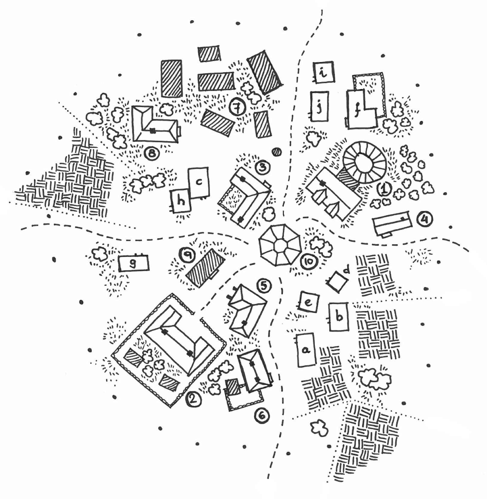

# Piedrainerte

Piedrainerte se levanta sobre una pequeña loma en medio del páramo, el último lugar habitado antes de la Montaña. La loma descansa sobre un lecho de roca sólida y es la única tierra firme en muchas leguas a la redonda. Cuatro senderos suben hasta ella desde los cuatro puntos cardinales. Alrededor, la turbera se extiende hasta donde alcanza la vista, parda y empapada, y apenas crece en ella otra cosa que musgo y juncos; sobre la loma, en cambio, hay matorrales y unas pocas arboledas dispersas entre las casas. Una hilera de hitos negros rodea el pueblo y marca hasta dónde llega la tierra firme.

Es un pueblo pequeño, de piedra y madera, acostumbrado a ver pasar aventureros. Allí se puede descansar antes de partir hacia la Montaña, curarse y abastecerse a la vuelta, e incluso asentarse, siempre que se respeten las normas del lugar.

<!-- Pendiente: estadísticas de los PNJ según el sistema elegido. -->

::: span-2-right

:::

## Historia

Nadie sabe con certeza cómo nació el pueblo. Según muchos de sus habitantes, la respuesta está en dos sitios a los que nadie tiene acceso: la torre-biblioteca del centro del pueblo, siempre cerrada, y la cabeza del viejo Feldric, de la que nadie consigue sacar dos frases seguidas con sentido.

Entre las casas que siguen en pie hay tres construcciones que destacan por su antigüedad y por un estilo distinto al del resto: el templo, la torre-biblioteca y las seis casas que el pueblo mantiene vacías. Los piedrainerteños discuten si el pueblo creció alrededor del templo o alrededor de la biblioteca; en lo que todos coinciden es en que esos edificios ya estaban allí cuando llegaron los primeros colonos, y en que quizá alguna de las civilizaciones que dominaron la Montaña levantó aquí un asentamiento anterior.

Cuando la Montaña empezó a atraer aventureros, estos acudían al pueblo en busca de lo que la biblioteca pudiera saber de ella y de los cuidados del templo para sus heridas. Algunos de los que volvieron decidieron quedarse en la loma, construyeron sus casas y empezaron a vender sus servicios. La leyenda de que "_quien domine la Montaña, dominará el mundo_" ha seguido trayendo gentes de todas partes, y muchas han dejado aquí su huella.

Lo que al principio no era más que un puñado de tiendas de campaña alrededor del templo es hoy un pueblo estable de más de veinte casas y una docena de familias, con fonda, taberna, almacén, herrería y una autoridad que imparte justicia.

## La moneda

En Piedrainerte se ven monedas, pero solo entre forasteros. Los piedrainerteños no las aceptan: comercian con lingotes de oro, plata y cobre puros, de 2, 4 y 12 onzas de peso.

En el pueblo se cuenta que la costumbre viene de un comerciante huraño que llegó a controlar todos los negocios y fijaba el valor de las monedas a su antojo. Lo cierto es que, tras un intento de estafa de un forastero, un juez decidió que solo se aceptaría metal puro. Hubo otra razón, relacionada con unas monedas embrujadas y con Feldric, pero el pueblo la ha olvidado y el viejo no está en condiciones de recordarla.

Quien quiera comprar algo o pagar un servicio tiene que fundir antes sus monedas, porque en el pueblo no se hace trueque ni se cambia moneda. Se encarga el herrero, que no cobra por ello: su trabajo se paga con el impuesto que el pueblo recauda de vez en cuando. Cada PJ decide cuántas monedas funde, y el DJ determina cuánta impureza contienen y cuánto metal puro recibe a cambio.

## Las seis casas

Dentro de los hitos debe haber siempre al menos seis casas sin habitantes, limpias y preparadas para que alguien pueda vivir en ellas en cualquier momento. Es la norma más antigua del pueblo y nadie la discute.

Todos saben lo que ocurre si se rompe. Basta con que alguien haga hogar en una de ellas, es decir, que viva allí más de cuatro días seguidos o que deshaga su petate y deje dentro sus cosas, para que esa misma noche los habitantes de una casa del pueblo, elegida en apariencia al azar, no despierten. Por la mañana los encuentran en sus camas, sin una herida, y las paredes de la casa cubiertas de hollín. Los piedrainerteños lo llaman la maldición.

Por eso el alguacil es especialmente seco con los forasteros, y todo el pueblo invita a los aventureros que quieren quedarse, cuando la fonda está llena, a acampar fuera de los hitos. Nadie vive en las seis casas sin el permiso expreso del pueblo.

Hay otra cosa que los forasteros no tardan en descubrir: más allá de los hitos no se puede construir. La loma, asentada sobre roca sólida, tiene el espacio justo para el pueblo, sus arboledas y su matorral, y los hitos marcan dónde termina la roca. Fuera, la turbera no sostiene unos cimientos; las casas se hunden, la madera se pudre con la humedad y la piedra se agrieta con las heladas. Por eso el pueblo no puede crecer. Muchos forasteros lo atribuyen también a la maldición, y los piedrainerteños no se molestan en corregirlos.

La verdad sobre las seis casas se explica más abajo, en la descripción de Ozrakhul.

::: striped span-2
| Mapa | Edificio                       | Quién vive o lo regenta                |
|:----:|:-------------------------------|:---------------------------------------|
|  1   | Templo                         | Hermano Tobin                          |
|  2   | Gran Fonda                     | Kellan y Korin                         |
|  3   | Casa de justicia               | Hemric Vale (juez) y Harlan (alguacil) |
|  4   | Hierbas y Pócimas (herbolario) | Feldric                                |
|  5   | La Carreta Rota (almacén)      | Arvel                                  |
|  6   | Herrería                       | Fargrim, que vive en ella              |
|  7   | Las seis casas deshabitadas    | Nadie                                  |
|  8   | Vieja posada                   | —                                      |
|  9   | Taberna                        | Fenn                                   |
|  10  | Torre-biblioteca               | Cerrada                                |
|  a   | Casa                           | Los Etnam, familia de medianos         |
|  b   | Casa                           | Los Farrow                             |
|  c   | Casa                           | Harlan y Hemric Vale                   |
|  d   | Casa                           | Feldric                                |
|  e   | Casa                           | Arvel                                  |
|  f   | Mansión                        | Eldrin                                 |
|  g   | Casa                           | Los Pell                               |
|  h   | Casa                           | Jessa                                  |
|  i   | Casa                           | Hermano Tobin                          |
|  j   | Casa                           | Fenn                                   |

Los puntos negros que rodean el pueblo en el mapa son los hitos que marcan su perímetro.
:::

## El pueblo

El pueblo se ordena en torno a un eje que va del templo (1) a la torre-biblioteca (10), en el centro, y de allí a la nueva fonda (2), al suroeste.

Al norte de ese eje están los dos edificios y el patio amurallado de la casa de justicia (3), donde el juez resuelve los pleitos del pueblo y de las tierras de alrededor. Tiene un pequeño calabozo para los asuntos menores: borrachos, peleas y algún ladrón de poca monta. Junto a ella, fuera del patio, está el pozo del que bebe todo el pueblo. Detrás de la casa de justicia se encuentran las seis casas deshabitadas (7), cinco de ellas alrededor de una sexta, todas en perfecto estado, y cerca de ellas la vieja posada (8).

Junto al templo, cerca del sendero que sale del pueblo hacia el este, se alza una casa grande: el herbolario de Feldric (4), donde se venden ungüentos, cataplasmas, pócimas y pastelillos para casi cualquier dolencia.

Al sureste de la biblioteca, pasada una zona de viviendas y camino de la fonda, están el almacén (5) y la herrería (6), los lugares más frecuentados por forasteros y vecinos. Allí se puede comprar casi de todo y conseguir el metal necesario para pagarlo. La taberna (9) queda al oeste, entre las casas.

## Personajes

### Feldric (mago de nivel 7)

Es un anciano olvidadizo que vive en el pueblo desde siempre: todos los vecinos lo recuerdan ya viejo, y nadie sabría decir si hubo alguien en Piedrainerte antes que él.

Sus costumbres son invariables. Al amanecer sale de su casa (d), se planta con paso rápido ante las puertas de la biblioteca, las mira y vuelve a casa pensativo. Al anochecer cierra su herbolario, Hierbas y Pócimas, y da una vuelta despacio alrededor de las seis casas antes de recogerse. Se le conoce por sus pócimas y elixires, y de vez en cuando por alguna explosión. Es muy despistado, y mantener con él una conversación coherente durante más de cinco minutos es casi imposible. Los vecinos lo tienen por un viejo excéntrico, aficionado a sus plantas y generoso con los precios.

**Secreto.** Feldric es el último guardián de la Orden de los Magos Carmesíes. Sostiene con su propia mente el sello que mantiene encerrado a Ozrakhul bajo las seis casas, y la unión con el sello la lleva colgada al cuello: una presea de plata que nunca se quita. Sostenerlo le ha ido consumiendo la cabeza; de ahí sus despistes. Custodia además el Códice Rojo, guardado en la torre-biblioteca, que contiene lo necesario para deshacer el encierro del demonio.

Cuando alguien hace hogar en una de las seis casas, el sello se debilita, la unión se suelta y Feldric recupera de golpe la lucidez y todo su poder. Pasa la noche conteniendo al demonio, que intenta llegar hasta el Códice, y al amanecer el sello vuelve a cerrarse y el viejo vuelve a ser el de siempre. Su paseo de cada anochecer alrededor de las seis casas es lo único que queda de su vigilancia consciente: él mismo no sabría explicar por qué lo hace.

::: monster
**Feldric** (mago humano de nivel 7, disposición ley/bien)
**PG** 17 · **CA** 10 [9] · **Movimiento** 9 metros · **Bonificador al ataque** +2
**Atributos principales** inteligencia, sabiduría y constitución
**Atributos destacados** inteligencia 18, sabiduría 15
**Armas** bastón y daga; no lleva armadura
**Conjuros por día** nivel 0: 5 · 1.º: 5 · 2.º: 4 · 3.º: 3 · 4.º: 1
**Conjuros habituales** luz, reparar, mensaje, descubrir veneno, prestidigitación; identificar, comprensión, leer escritura arcana, sueño, proyectil del mago; localizar objeto, ver lo invisible, discernir pensamientos, levitar; disipar magia, círculo mágico, inmovilizar humanoide; globo menor de protección contra conjuros
**Equipo** presea de plata, libro de conjuros, hierbas y frascos de su herbolario
**El sello** mientras el sello está cerrado, Feldric no prepara conjuros por encima del nivel 0. La noche en que el sello se debilita recupera la ficha completa.
:::

<!-- Ficha comprobada con el Players Handbook de Castles & Crusades (PDF, numeración impresa):
- Mago: dado de golpe d4 por nivel hasta el 10; bonificador al ataque +2 a nivel 7; armas: club, dagger, dart, staff; sin armadura (págs. 74-75). PG 17 = media de 7d4 (17,5), constitución sin modificador.
- Conjuros por día a nivel 7: 5/4/3/2/1; inteligencia 18-19 añade uno de 1.º, 2.º y 3.º, acumulativos (págs. 76-77).
- Las capacidades del mago a partir del nivel 13 (detectar magia, contraconjuro...) no aplican a nivel 7 (págs. 77-78).
- Humanos: tres atributos principales, uno fijado por la clase (págs. 14-15). Modificadores: 13-15 +1, 16-17 +2, 18-19 +3 (pág. 14).
- PG: dado de clase + modificador de constitución por nivel (págs. 12 y 15). CA base 10 (pág. 251). Movimiento humano 30 pies (pág. 96), 9 metros con la equivalencia de 1,5 m por cada 5 pies.
- Disposición en formato primaria/secundaria, p. ej. law/good (págs. 98-99).
- Conjuros (nombre original, nivel de mago): Light 0, Mending 0, Message 0, Discover Poison 0, Prestidigitation 0; Identify 1, Comprehension 1, Read Arcane Script 1, Sleep 1, Magi's Missile 1; Locate Item 2, See Invisible 2, Discern Thoughts 2, Levitate 2; Dispel Magic 3, Magic Circle 3, Hold Humanoid 3; Minor Globe of Spell Protection 4 (lista de conjuros de mago, págs. 123-125, y descripciones).
- Formato de la línea de estadísticas según los módulos de Troll Lord Games (Castle Zagyg: Dark Chateau).
- "El sello" es una regla propia de esta aventura, no del reglamento.
- Las traducciones de los nombres de conjuros son provisionales: sustituir por las de la edición española si se usa. -->

### Hermano Tobin (clérigo de nivel 4)

Tiene unos cuarenta y cinco años y un aspecto cansado y bonachón. Puede decirse que fue el primer habitante del pueblo en su época actual, si se exceptúa a Feldric.

Es un clérigo bondadoso y tan ingenuo que sus vecinos, unos con cariño y otros con sorna, lo tienen por un alma cándida. No niega nada a nadie, siempre busca arreglarlo todo por las buenas y se niega en redondo a que haya violencia en su casa (i) o en el templo que atiende. Tiene muy pocas posesiones, pero una de ellas, su símbolo sagrado tallado en madera, está tan impregnada de su santidad que la maldición nunca alcanza su casa ni el templo mientras él esté dentro.

**Secreto.** Antes de convertirse fue inquisidor de otro dios, más beligerante, y mandó a la hoguera a muchos fieles de su fe actual. Muchos familiares de aquellos ajusticiados quieren su cabeza. Tras su conversión aceptó como penitencia instalarse en Piedrainerte y fundar una misión, y en ello sigue.

### Harlan (explorador de nivel 3)

Es el alguacil de Piedrainerte, un hombre hosco con una cojera muy visible, al que acompaña siempre un búho hembra de pésimo carácter. Vive detrás de la casa de justicia, en la casa (c), y trata especialmente mal a los forasteros: los invita a pasar la noche en sus tiendas, fuera de los hitos, y les recuerda que allí él no tiene jurisdicción y pueden hacer lo que quieran. Dentro del pueblo es el brazo armado de la ley: se ocupa de las trifulcas y las peleas de poca monta, y mantiene a los presos hasta que se los llevan a la ciudad o quedan libres.

Cuenta a todo el mundo que se quedó cojo en los niveles superiores de la Montaña. Pocos se atreven a contradecirle, y más de uno ha pasado la noche en el calabozo por intentarlo. Harlan no debe lealtad a nadie salvo a su superior, el juez Hemric Vale, con quien comparte casa.

**Secreto.** Su cojera es fruto de un accidente estúpido. Nunca ha puesto un pie en la Montaña, aunque conoce bien los caminos que llevan hasta ella.

### Hemric Vale (paladín caído de nivel 4)

Hace años era un joven paladín, defensor de su fe, encargado de proteger personas y lugares. En su último destino como guardián se dejó seducir, y delante de sus narices robaron una reliquia de su iglesia, un collar de plata. Su dios le ordenó unirse a una expedición a la Montaña para recuperarla. El asalto fracasó, Hemric desoyó el mandato de su dios y perdió su gracia hasta que expíe por completo sus faltas.

Lleva cinco años en Piedrainerte, en la misma casa que el alguacil (c). Tiene treinta y cinco años, no es muy alto, empieza a perder pelo y la barba le clarea de canas. No conserva ninguna de las capacidades de un paladín, pero el pueblo lo reconoce como autoridad judicial y se encarga de recaudar el impuesto. Intenta volver al buen camino trabajando por la comunidad según la justicia de su dios. Todos en el pueblo saben que ya no es un paladín, y procuran que los forasteros no lo sepan.

**Secreto.** Su obsesión por recuperar el favor de su dios le ha hecho perder el rumbo. En una parte de la casa a la que solo entra él, y que Harlan no conoce, tiene un pequeño altar ante el que reza cada noche. Desde hace tiempo una voz confusa le habla en sueños y le promete la gracia perdida y la reliquia. Hemric cree que es su dios; es Ozrakhul. La figura del altar está cambiando poco a poco y sus facciones se parecen cada vez más a las del hombre de piel, pelo y ojos negros que ve en sueños.

Fue esa voz la que le sugirió que fuera generoso con los recién llegados y dejara a Kellan y Korin instalarse en una de las seis casas, lo que acabó en la desgracia de la Gran Fonda. Ozrakhul querrá servirse de él, y de su autoridad, para llegar al Códice Rojo o para librarse de Feldric: encarcelar al viejo con cualquier pretexto o autorizar que alguien ocupe otra de las casas.

### Kellan y Korin (guerreros de nivel 2)

Son gemelos de unos treinta años, idénticos en todo salvo en su forma de entender lo que está bien y lo que está mal. Chocan cada vez que hay que tomar una decisión, discuten y acaban resolviendo sus disputas a suertes o con la mediación de alguien, porque a golpes ya han conocido demasiadas veces las celdas del pueblo.

Llegaron con un grupo de aventureros y, con permiso del juez, se instalaron en una de las casas vacías. Discutían a diario, y después de cada pelea Kellan se iba a dormir a otra de las casas y dejaba allí su petate. Sin que nadie se diera cuenta, los gemelos habían ocupado dos casas, y la maldición cayó sobre la Gran Fonda: se llevó a la familia de su dueño, Edric Kell, y a más de diez huéspedes. Después de aquello los gemelos se quedaron con la fonda, en el único acuerdo al que han llegado nunca.

Desde entonces dan techo, comida y bebida a los forasteros y a los vecinos que lo necesitan. Siguen discutiendo por cualquier nimiedad, pero no se meten en las peleas ajenas y consiguen que dentro de la Gran Fonda no haya trifulcas.

**Secreto.** Kellan comprendió más tarde que la culpa fue suya, y lo calla. Lo que no sabe es que no fue casualidad: en aquellos días soñaba a menudo con las casas vacías, y algo en esos sueños lo empujaba hacia ellas.

### Arvel (ladrón de nivel 6)

Es un hombrecillo menudo y delgado que vive en una casa pequeña (e) no lejos del almacén que regenta, La Carreta Rota. Fue ladrón a sueldo y ha colgado las ganzúas. Es honesto a su manera: valora los trabajos y tasa los objetos con justicia, y si se equivoca es por falta de información, nunca por mala fe. Tiene además un código: no mata a nadie.

En su almacén todo tiene un precio justo. Compra a su valor real y vende con un recargo de entre el 1 % y el 5 %. No pretende enriquecerse; ya tiene suficiente, y el almacén es su forma de vida.

**Secreto.** Nadie abandona el Gremio: quien entra pertenece a él hasta la muerte, y a veces ni siquiera la muerte lo libra. Arvel lo ha dejado y sabe que no puede bajar la guardia. En su casa guarda en un arcón su equipo de ladrón, y en un baúl protegido por varias trampas y cerraduras, un pergamino que explica dónde y cómo escondió el tesoro de toda su carrera. En ese mismo baúl hay un cofre pequeño con su seguro: unos pergaminos que describen dónde está la sede del Gremio y cómo asaltar sin riesgo su caja de caudales. Se ha ocupado de que el Gremio sepa que existen. El cofre está encantado: si Arvel muere o se aleja más de 5 kilómetros de él, las defensas del baúl se desactivan y el cofre desaparece rumbo a un lugar que solo él conoce.

### Fargrim (enano de nivel 3)

Lleva más de doce años en el pueblo. Llegó poco después que el hermano Tobin y es su mejor amigo. Tolera las rarezas de Feldric y acepta a Hemric como la ley del pueblo. Es quizá el piedrainerteño que mejor recibe a los forasteros, y siempre tiene una jarra fresca de cerveza para quien entre en la herrería, que fundó y en la que vive.

Es también el vecino más apreciado, porque es el único capaz de hacer la moneda del pueblo: funde los metales en su fragua, los separa de sus impurezas y de otros metales, y obtiene lingotes de oro, plata y cobre puros. Es extremadamente honrado y no cobra por su trabajo, porque el pueblo le da lo que necesita y le entrega la materia prima que Hemric recauda como impuesto.

Si un forastero intenta llevarse algo por la fuerza, por buen luchador que sea, Fargrim no hace nada por impedirlo: sabe que el pueblo saldrá en su defensa.

### Eldrin (elfo de nivel 5)

Es un elfo muy bien vestido que casi siempre habla en élfico, y su orgullo le impide tratar como a un igual a nadie del pueblo. Vive en una mansión detrás del templo (f) y, en apariencia, su único papel en Piedrainerte es tocar y cantar en élfico en la taberna cuando le apetece, que es casi siempre. Bajo la ropa lleva un fajín carmesí bordado con símbolos élficos que procura que no se vea.

**Secreto.** Eldrin es un agente de la Orden de los Magos Carmesíes, y su misión es que a Feldric no le pase nada. Con la mente nublada por el sello, el viejo se comporta a menudo como un niño, y Eldrin tiene que hacer de niñera. No le gusta, pero entiende lo que está en juego y cumple. Hasta ahora ha frustrado los dos intentos de acabar con el viejo.

### Ozrakhul

Ninguno de los vecinos de Piedrainerte lo ha visto nunca, y casi ninguno conoce su nombre.

Hace siglos, la Orden de los Magos Carmesíes se enfrentó a un demonio al que no pudo destruir. Lo encerró por la fuerza en el cuerpo de un hombre, un cuerpo que desde entonces no envejece ni se corrompe, y lo enterró en una cámara excavada en la roca de la loma. Sobre la tumba levantó una casa, y alrededor otras cinco, cada una sobre una de las piedras del sello. Para protegerlas no puso guardias, sino una norma: esas casas no se habitan. El sello solo resiste mientras nadie haga hogar encima, y la maldición que todo el pueblo teme no es más que lo que ocurre cuando alguien lo hace.

Ozrakhul no puede salir. Cuando el sello se debilita, empuja desde dentro durante una noche e intenta llegar hasta el Códice Rojo; antes de que Feldric vuelva a cerrarlo, se lleva las almas de los habitantes de una casa. Al amanecer solo quedan los cuerpos y el hollín.

Lo que sí puede hacer, incluso con el sello entero, es hablar en sueños. Quien duerme cerca de las seis casas sueña a veces con un hombre de piel, pelo y ojos negros que habla de forma confusa y enigmática, mezclando promesas, ruegos y advertencias. Así empujó a Kellan hacia las casas vacías y así engaña a Hemric. Cuando detecta en el pueblo a un grupo de aventureros poderosos, se les aparece en sueños para convencerlos de que el viejo loco del herbolario es un peligro y deben acabar con él. Si el guardián muere, el sello queda sin quien lo sostenga.

## Familias

Además de estos personajes, en las casas (a), (b), (g), (h) y (j) viven antiguos aventureros que se establecieron en el pueblo, algunos con familias enteras. En (a) viven los Etnam, una familia de medianos tranquila y pacífica. En (b) viven los Farrow, una familia formada por dos guerreros que volvieron de la Montaña y decidieron quedarse. En (g) viven los Pell, que tienen pleitos de tierras con los Farrow. En (h) vive Jessa, una mujer callada que trabaja de camarera en la taberna. La taberna la lleva Fenn, que vive en (j): un antiguo ratero de ciudad que ha entendido que vive mejor como tabernero que como robabolsas.
